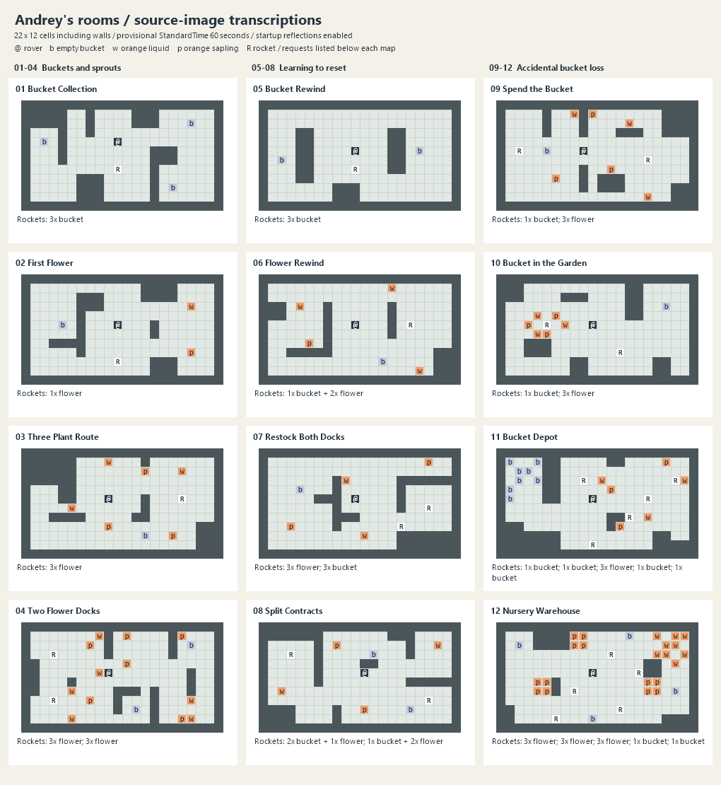

# Andrey's image rooms

Twelve faithful transcriptions of the supplied legend and numbered scheme, using the original 22 x 12 cell grid including walls. Red maps to the game's orange (A). Coordinates in rooms.json are zero-based, left-to-right and top-to-bottom; rocket coordinates refer to the rocket body, not the request icons above it.

All new rooms have StandardTime = 60 seconds, timing and room reset enabled, and both startup reflections enabled directly on the Room component. Existing room options are preserved on a rebuild. No shared config assets or gameplay-rule changes are introduced. These standalone rooms are not added to existing level pools.

| Room | Source family | Buckets | Liquid portions | Saplings | Rocket requests |
|---|---|---:|---:|---:|---|
| 01 Bucket Collection | Ведро и ростки / Buckets and sprouts | 3 | 0 | 0 | (10,7): 3 x Bucket |
| 02 First Flower | Ведро и ростки / Buckets and sprouts | 1 | 1 | 1 | (10,9): 1 x Flower A |
| 03 Three Plant Route | Ведро и ростки / Buckets and sprouts | 1 | 3 | 3 | (17,5): 3 x Flower A |
| 04 Two Flower Docks | Ведро и ростки / Buckets and sprouts | 2 | 6 | 6 | (3,3): 3 x Flower A; (3,8): 3 x Flower A |
| 05 Bucket Rewind | Учимся ресетить / Learning to reset | 2 | 0 | 0 | (10,7): 3 x Bucket |
| 06 Flower Rewind | Учимся ресетить / Learning to reset | 1 | 3 | 1 | (16,5): 1 x Bucket, 2 x Flower A |
| 07 Restock Both Docks | Учимся ресетить / Learning to reset | 1 | 2 | 2 | (18,6): 3 x Flower A; (15,8): 3 x Bucket |
| 08 Split Contracts | Учимся ресетить / Learning to reset | 2 | 2 | 2 | (3,3): 1 x Flower A, 2 x Bucket; (18,8): 1 x Bucket, 2 x Flower A |
| 09 Spend the Bucket | Случайная потеря ведра / Accidental bucket loss | 1 | 3 | 3 | (2,5): 1 x Bucket; (16,6): 3 x Flower A |
| 10 Bucket in the Garden | Случайная потеря ведра / Accidental bucket loss | 1 | 3 | 3 | (5,5): 1 x Bucket; (13,8): 3 x Flower A |
| 11 Bucket Depot | Случайная потеря ведра / Accidental bucket loss | 8 | 3 | 3 | (9,3): 1 x Bucket; (19,3): 1 x Bucket; (16,5): 3 x Flower A; (14,7): 1 x Bucket; (10,10): 1 x Bucket |
| 12 Nursery Warehouse | Случайная потеря ведра / Accidental bucket loss | 4 | 9 | 12 | (8,7): 3 x Flower A; (12,3): 3 x Flower A; (13,9): 3 x Flower A; (15,5): 1 x Bucket; (6,10): 1 x Bucket |

## Validation

PASS: 52 full Unity Play Mode runs: all four horizontal/vertical reflection combinations for every room, plus an early bucket delivery followed by rewind in rooms 09-12. Each run checked all authored wall/object cells and request counts, performed real arm extension/release, bucket filling, watering, harvesting and delivery, and registered final room completion. Rewinds preserved outstanding rocket requests and did not restore the scoring clock.

The driver invokes the existing RoomResetController.ResetRoom method to verify state persistence. It does not test physical player input charging or establish human completion times; 60 seconds is provisional. Counts describe executable test routes, not minimum actions or minimum rewinds. Reflections use deterministic random seeds and the actual room startup reflection implementation. Later recovery checks use a fixed test timestep and sample after each game update to avoid missed release cells; this affects only the isolated driver, not the room assets. No source geometry or resource counts were modified to make a solution work. The source image, legend, wall extraction utility and manually reviewed manifest are in Tools/AndreyRooms.

| Room | Orientation / scenario | Interactions | Movement segments | Rewinds |
|---|---|---:|---:|---:|
| 01 Bucket Collection | H=False, V=False | 6 | 17 | 0 |
| 01 Bucket Collection | H=True, V=False | 6 | 17 | 0 |
| 01 Bucket Collection | H=False, V=True | 6 | 17 | 0 |
| 01 Bucket Collection | H=True, V=True | 6 | 17 | 0 |
| 02 First Flower | H=False, V=False | 5 | 8 | 0 |
| 02 First Flower | H=True, V=False | 5 | 8 | 0 |
| 02 First Flower | H=False, V=True | 5 | 8 | 0 |
| 02 First Flower | H=True, V=True | 5 | 8 | 0 |
| 03 Three Plant Route | H=False, V=False | 15 | 19 | 0 |
| 03 Three Plant Route | H=True, V=False | 15 | 19 | 0 |
| 03 Three Plant Route | H=False, V=True | 15 | 19 | 0 |
| 03 Three Plant Route | H=True, V=True | 15 | 19 | 0 |
| 04 Two Flower Docks | H=False, V=False | 32 | 45 | 0 |
| 04 Two Flower Docks | H=True, V=False | 32 | 46 | 0 |
| 04 Two Flower Docks | H=False, V=True | 32 | 45 | 0 |
| 04 Two Flower Docks | H=True, V=True | 32 | 46 | 0 |
| 05 Bucket Rewind | H=False, V=False | 6 | 8 | 1 |
| 05 Bucket Rewind | H=True, V=False | 6 | 8 | 1 |
| 05 Bucket Rewind | H=False, V=True | 6 | 8 | 1 |
| 05 Bucket Rewind | H=True, V=True | 6 | 8 | 1 |
| 06 Flower Rewind | H=False, V=False | 12 | 17 | 1 |
| 06 Flower Rewind | H=True, V=False | 12 | 17 | 1 |
| 06 Flower Rewind | H=False, V=True | 12 | 17 | 1 |
| 06 Flower Rewind | H=True, V=True | 12 | 17 | 1 |
| 07 Restock Both Docks | H=False, V=False | 22 | 51 | 3 |
| 07 Restock Both Docks | H=True, V=False | 22 | 49 | 3 |
| 07 Restock Both Docks | H=False, V=True | 22 | 51 | 3 |
| 07 Restock Both Docks | H=True, V=True | 22 | 49 | 3 |
| 08 Split Contracts | H=False, V=False | 21 | 38 | 2 |
| 08 Split Contracts | H=True, V=False | 21 | 38 | 2 |
| 08 Split Contracts | H=False, V=True | 21 | 38 | 2 |
| 08 Split Contracts | H=True, V=True | 21 | 38 | 2 |
| 09 Spend the Bucket | H=False, V=False | 18 | 19 | 0 |
| 09 Spend the Bucket | H=True, V=False | 18 | 19 | 0 |
| 09 Spend the Bucket | H=False, V=True | 18 | 19 | 0 |
| 09 Spend the Bucket | H=True, V=True | 18 | 19 | 0 |
| 09 Spend the Bucket | early bucket + rewind | 18 | 17 | 1 |
| 10 Bucket in the Garden | H=False, V=False | 17 | 21 | 0 |
| 10 Bucket in the Garden | H=True, V=False | 17 | 21 | 0 |
| 10 Bucket in the Garden | H=False, V=True | 17 | 21 | 0 |
| 10 Bucket in the Garden | H=True, V=True | 17 | 21 | 0 |
| 10 Bucket in the Garden | early bucket + rewind | 19 | 23 | 1 |
| 11 Bucket Depot | H=False, V=False | 24 | 27 | 0 |
| 11 Bucket Depot | H=True, V=False | 24 | 27 | 0 |
| 11 Bucket Depot | H=False, V=True | 24 | 27 | 0 |
| 11 Bucket Depot | H=True, V=True | 24 | 27 | 0 |
| 11 Bucket Depot | early bucket + rewind | 24 | 28 | 1 |
| 12 Nursery Warehouse | H=False, V=False | 50 | 60 | 0 |
| 12 Nursery Warehouse | H=True, V=False | 50 | 60 | 0 |
| 12 Nursery Warehouse | H=False, V=True | 50 | 60 | 0 |
| 12 Nursery Warehouse | H=True, V=True | 50 | 60 | 0 |
| 12 Nursery Warehouse | early bucket + rewind | 49 | 59 | 1 |

## Resource notes

05 needs a rewind because two buckets must satisfy three requests. 06 needs a rewind to harvest its single sapling twice. 07 and 08 require restocking both flower or bucket supplies; bank useful deliveries before restoring the room. In 09 and 10, delivering the only bucket before gardening requires recovery. 11 provides eight buckets for four bucket requests and three flowers. 12 provides four buckets, nine liquids, twelve saplings and nine flower requests; three saplings can remain unused. Rocket launches and fulfilled requests remain preserved across resets.
