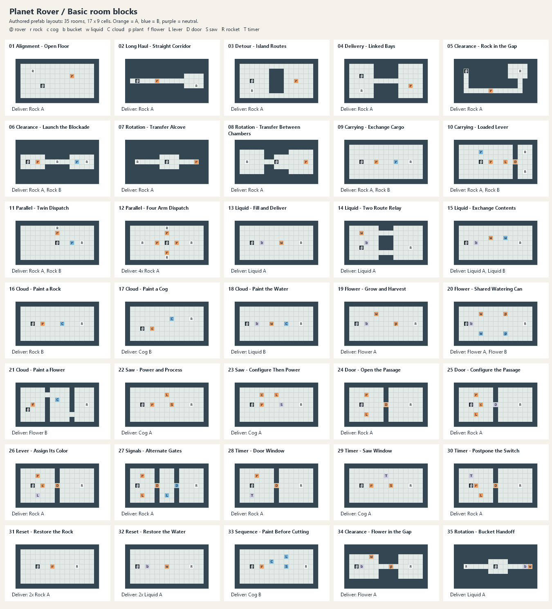

# Basic room blocks

35 standalone 17 x 9 room prefabs. Use Assets > Test Room to run any prefab. These are vocabulary studies, not a production level pool; none was added to an existing level. All use Default Room Config; the inherited 30-second StandardTime is provisional, not a human-calibrated score target.

The framework's earlier one-rock experiment and all-four-directions requirement are not imposed on these full-mechanic studies. No Danger or Visibility mechanics are introduced. Rotation means changing arms, never rotating the rover. Baseline interactions are not artificially labeled Carrying or Timing. Geometry labels refer to the route used for the task; stationary workstations do not exercise the Flexible/Fixed path-choice axis.

## Vocabulary and geometry comparisons

01-04 compare alignment, long straight carry, alternate island routes, and linked bays. 07-08 hold the transfer task constant while changing spatial division; 13-14 compare open liquid delivery with a two-connection relay. 05/06/34 compare rock, rocket, and plant clearance. 16/17/18/21 compare cloud effects on different cargo. 24/25/26 isolate signaling a door, configuring a door, and configuring a lever. 28/29/30 compare timed passage, timed processing, and postponement. 31/32 contrast renewable solid and liquid supply across a rewind.

| Room | Challenge emphasis | Task geometry | Reusable situation | Qualification |
|---|---|---|---|---|
| 01 Alignment - Open Floor | Navigation | Direct / Flexible / Singular | Find the row and approach side for one delivery. |  |
| 02 Long Haul - Straight Corridor | Navigation | Mostly direct / Fixed / Fractured | Carry down one long corridor into a delivery bay, contrasting with turn-heavy travel. |  |
| 03 Detour - Island Routes | Navigation | Winding / Flexible / Singular | Choose the upper or lower route around a central island. |  |
| 04 Delivery - Linked Bays | Navigation | Winding / Fixed / Fractured | Work in two offset bays joined by one narrow connection. |  |
| 05 Clearance - Rock in the Gap | Obstacles | Winding / Fixed / Fractured | The required rock blocks the only connection; collecting it opens passage. |  |
| 06 Clearance - Launch the Blockade | Obstacles, Order of operations | Direct / Fixed / Fractured | Launch the first rocket to access a second pickup and unfinished rocket. |  |
| 07 Rotation - Transfer Alcove | Rotation | Direct / Fixed / Singular | Pickup is right-facing and delivery left-facing; the alcove permits a handoff. |  |
| 08 Rotation - Transfer Between Chambers | Rotation | Direct / Fixed / Fractured | The same handoff task occupies a central bay between separate workspaces. |  |
| 09 Carrying - Exchange Cargo | Carrying | Direct / Flexible / Singular | An occupied arm exchanges rocks; recover the deposited rock for the other request. | Exchange is demonstrated as an efficient option, not forced; separate deliveries remain possible. |
| 10 Carrying - Loaded Lever | Carrying | Direct / Fixed / Fractured | Operate the lever without discarding held cargo, then deliver both resources across the gate. |  |
| 11 Parallel - Twin Dispatch | Simultaneous action, Carrying | Direct / Stationary workstation / Singular | Two arms can collect, retract and deliver in parallel from one workstation. | Parallel action improves throughput; it is not a strict simultaneity lock. |
| 12 Parallel - Four Arm Dispatch | Simultaneous action, Carrying | Direct / Stationary workstation / Singular | One shared position supports four useful pickup and delivery lines. | Parallel action improves throughput; it is not a strict simultaneity lock. |
| 13 Liquid - Fill and Deliver | Baseline interaction | Direct / Flexible / Singular | Collect one portion in a bucket; delivery returns the empty container. |  |
| 14 Liquid - Two Route Relay | Navigation | Winding / Flexible / Fractured | Keep the fill-and-deliver task, but choose between two connections joining the work bays. |  |
| 15 Liquid - Exchange Contents | Carrying | Direct / Flexible / Singular | Swap a filled bucket with a source; the displaced liquid remains available for a later delivery. | The tested route demonstrates swapping; delivering each color before refilling is an alternative. |
| 16 Cloud - Paint a Rock | Order of operations | Direct / Flexible / Singular | A wrong-color rock needs one cloud before delivery. |  |
| 17 Cloud - Paint a Cog | Order of operations | Winding / Flexible / Singular | Keep the recoloring task but offset its stations; cogs retain type when recolored. |  |
| 18 Cloud - Paint the Water | Order of operations | Direct / Flexible / Singular | Fill first: a cloud recolors liquid inside a bucket but cannot fill an empty one. |  |
| 19 Flower - Grow and Harvest | Order of operations | Winding / Flexible / Singular | Water a matching plant; harvest is a separate action while the bucket remains held. |  |
| 20 Flower - Shared Watering Can | Carrying, Order of operations | Winding / Flexible / Singular | Reuse one bucket for two colors and two plants; preserve the container while harvesting. |  |
| 21 Cloud - Paint a Flower | Order of operations, Navigation | Winding / Fixed / Fractured | Carry a pre-grown flower through three bays; recolor in the middle bay before delivering in the last. |  |
| 22 Saw - Power and Process | Order of operations | Direct / Flexible / Singular | Select the saw's signal, then convert a matching rock into a cog. |  |
| 23 Saw - Configure Then Power | Order of operations | Winding / Flexible / Singular | Spend a starter cog on a neutral saw; configuration and powering are separate steps. |  |
| 24 Door - Open the Passage | Navigation | Direct / Fixed / Fractured | A lever opens the only passage to the delivery bay. |  |
| 25 Door - Configure the Passage | Order of operations | Direct / Fixed / Fractured | Use a cog to assign the door, then emit its matching signal. |  |
| 26 Lever - Assign Its Color | Order of operations | Direct / Fixed / Fractured | A cog colors the neutral lever; a second interaction emits the signal. |  |
| 27 Signals - Alternate Gates | Order of operations, Navigation | Direct / Fixed / Fractured | Switch orange to blue in the middle bay; the second signal closes the route behind you. |  |
| 28 Timer - Door Window | Timing | Direct / Fixed / Fractured | Wait for orange, then carry the rock through the timed opening. |  |
| 29 Timer - Saw Window | Timing | Direct / Flexible / Singular | Prepare the rock, then process it during the orange power interval. |  |
| 30 Timer - Postpone the Switch | Timing, Carrying | Direct / Fixed / Fractured | The orange lever restarts the countdown to blue; use it to extend an open-door window. | Lever use demonstrates postponement; fast teams can cross without it. No strict concurrency claim. |
| 31 Reset - Restore the Rock | Reset | Direct / Flexible / Singular | Two identical requests and one rock force a supply rewind after banking the first delivery. |  |
| 32 Reset - Restore the Water | Reset | Direct / Flexible / Singular | One liquid portion serves two requests across a rewind; the bucket and source reset while delivery persists. |  |
| 33 Sequence - Paint Before Cutting | Order of operations | Winding / Flexible / Singular | The blue saw cannot process the orange rock until the cloud recolors it. |  |
| 34 Clearance - Flower in the Gap | Obstacles, Order of operations | Direct / Fixed / Fractured | Grow the blocking plant, park the bucket, then harvest the flower to clear the passage. |  |
| 35 Rotation - Bucket Handoff | Rotation, Carrying | Direct / Fixed / Singular | Fill on the right, transfer the whole filled bucket, and deliver its liquid on the left. |  |

## Validation

PASS: all 35 completed by automated real-time Unity Play Mode input using actual Rover.OnPress/OnRelease/OnDrop and the existing reset controller. Tests verified every authored cell, prefab links and shared config, rocket requests, simultaneous arm batches, timer windows and postponement, and rocket persistence across mandatory resets. No gameplay rule was replaced by a symbolic simulation.

This verifies an executable intended route, not uniqueness of the solution, mandatory use of every direction, absence of every possible softlock, or four-human enjoyment. Parallelism is an opportunity rather than a strict lock. Exchange Cargo, Exchange Contents and Postpone the Switch intentionally permit alternatives. Human playtests should compare route feel, legibility, cooperation and timing targets. Keep each literal prefab exclusive to one future production pool and never request more completions than unique rooms.

## Tested routes

Coordinates are (column, row), zero-based from the top left. A/B mean orange/blue. `act` navigates to a valid stance and releases the indicated arm on the object; `go` moves to an empty cell. `parallel` extends all listed arms concurrently. `reset` invokes the cooperative hold countdown and asserts delivery persistence. Navigation is planned over current grid occupancy; interactions and movement execute in real frames.

- **01 Alignment - Open Floor**: act Right (11,3) -> act Right (3,2).
- **02 Long Haul - Straight Corridor**: act Right (6,4) -> act Right (14,5).
- **03 Detour - Island Routes**: act Right (12,4) -> act Right (3,6).
- **04 Delivery - Linked Bays**: act Right (13,5) -> act Right (3,6).
- **05 Clearance - Rock in the Gap**: act Right (7,6) -> act Right (13,2).
- **06 Clearance - Launch the Blockade**: act Right (4,4) -> act Right (8,4) -> act Right (12,4) -> act Right (14,4).
- **07 Rotation - Transfer Alcove**: act Right (14,4) -> drop Right -> act Left (9,4) -> act Left (2,4).
- **08 Rotation - Transfer Between Chambers**: act Right (14,4) -> drop Right -> act Left (9,4) -> act Left (2,4).
- **09 Carrying - Exchange Cargo**: act Right (6,4) -> act Right (10,4) -> act Right (13,4) -> act Right (10,4) -> act Right (13,4).
- **10 Carrying - Loaded Lever**: act Right (7,4) -> act Up (5,2) -> act Right (10,4) -> go (13,4) -> act Right (14,2) -> act Up (14,6).
- **11 Parallel - Twin Dispatch**: parallel Up/Right -> parallel Up/Right.
- **12 Parallel - Four Arm Dispatch**: parallel Up/Left/Down/Right -> parallel Up/Left/Down/Right.
- **13 Liquid - Fill and Deliver**: act Right (5,4) -> act Right (9,4) -> act Right (13,4).
- **14 Liquid - Two Route Relay**: act Right (4,4) -> act Right (3,2) -> act Right (13,5).
- **15 Liquid - Exchange Contents**: act Right (4,4) -> act Right (7,3) -> act Right (10,3) -> act Right (13,4) -> act Right (10,3) -> act Right (13,4).
- **16 Cloud - Paint a Rock**: act Right (5,4) -> act Right (9,4) -> act Right (13,4).
- **17 Cloud - Paint a Cog**: act Right (5,5) -> act Right (9,3) -> act Right (13,3).
- **18 Cloud - Paint the Water**: act Right (4,4) -> act Right (7,4) -> act Right (10,4) -> act Right (13,4).
- **19 Flower - Grow and Harvest**: act Right (4,4) -> act Right (6,2) -> act Right (10,4) -> act Up (10,4) -> act Up (14,4).
- **20 Flower - Shared Watering Can**: act Right (3,4) -> act Right (5,2) -> act Right (10,2) -> act Up (10,2) -> act Up (14,4) -> act Right (5,6) -> act Right (10,6) -> act Up (10,6) -> act Up (14,4).
- **21 Cloud - Paint a Flower**: act Right (3,4) -> act Right (8,3) -> act Right (14,4).
- **22 Saw - Power and Process**: act Right (5,4) -> act Up (8,2) -> act Right (9,4) -> act Right (13,4).
- **23 Saw - Configure Then Power**: act Right (5,4) -> act Up (5,2) -> act Up (9,4) -> act Up (8,2) -> act Right (9,4) -> act Right (13,4).
- **24 Door - Open the Passage**: act Right (4,2) -> act Right (4,6) -> go (12,4) -> act Right (13,4).
- **25 Door - Configure the Passage**: act Right (5,4) -> act Right (8,4) -> act Right (4,6) -> act Right (4,2) -> go (12,4) -> act Right (13,4).
- **26 Lever - Assign Its Color**: act Right (5,4) -> act Right (4,6) -> act Right (4,6) -> act Right (4,2) -> go (12,4) -> act Right (13,4).
- **27 Signals - Alternate Gates**: act Right (3,2) -> act Right (3,6) -> go (8,4) -> act Down (8,6) -> go (12,4) -> act Right (14,4).
- **28 Timer - Door Window**: act Right (4,2) -> door (8,4) -> go (12,4) -> act Right (13,4).
- **29 Timer - Saw Window**: act Right (5,4) -> saw (9,4) -> act Right (9,4) -> act Right (13,4).
- **30 Timer - Postpone the Switch**: act Right (4,4) -> door (8,4) -> wait 1s -> postpone Right (5,6) -> go (12,4) -> act Right (13,4).
- **31 Reset - Restore the Rock**: act Right (7,4) -> act Right (12,4) -> reset -> act Right (7,4) -> act Right (12,4).
- **32 Reset - Restore the Water**: act Right (4,4) -> act Right (8,4) -> act Right (13,4) -> reset -> act Right (4,4) -> act Right (8,4) -> act Right (13,4).
- **33 Sequence - Paint Before Cutting**: act Right (5,4) -> act Right (7,3) -> act Up (10,2) -> act Right (10,4) -> act Right (14,4).
- **34 Clearance - Flower in the Gap**: act Right (3,4) -> act Right (5,2) -> act Right (9,4) -> go (5,5) -> drop Right -> act Right (9,4) -> go (12,4) -> act Right (13,4).
- **35 Rotation - Bucket Handoff**: act Right (14,4) -> act Right (15,4) -> drop Right -> act Left (9,4) -> act Left (2,4).
