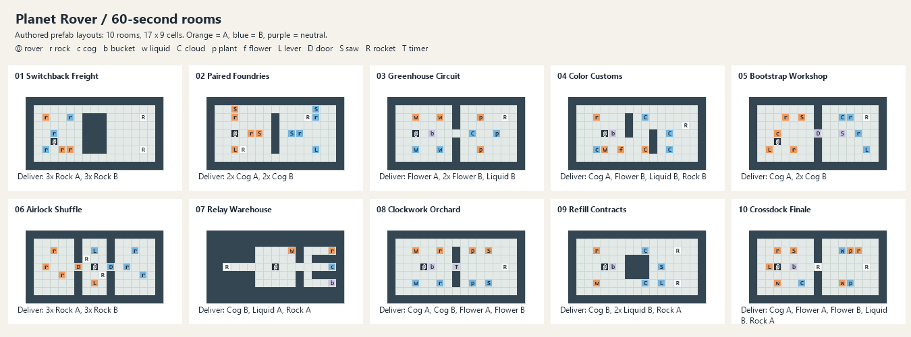

# 60-second room studies

Ten standalone 17 x 9 rooms combining the basic vocabulary into multi-stage cooperative work. All use the default options on the Room component and have StandardTime = 60 seconds. This is a scoring target, not a forced duration: coordinated teams can finish faster. No idle waiting was added to pad the duration; the timer serves actual saw-power windows.

Target audience: teams familiar with the basic blocks, primarily four players. Aim for roughly 45-90 seconds on early informed attempts, centered near 60; actual human timings still need measurement. Longer work comes from carrying decisions, return trips, production dependencies, signal transitions and handoffs. Reset remains available in every room; only Refill Contracts deliberately requires it. These are standalone prototypes, not additions to an existing lobby or repeated level pool.

| Room | Challenge emphasis | Geometry | Work rhythm |
|---|---|---|---|
| 01 Switchback Freight | Navigation, Carrying | Winding / Flexible / Singular | Batch six rocks on different arms; choose upper and lower routes around the freight island. Two docks demand three orange and three blue rocks. |
| 02 Paired Foundries | Simultaneous action, Carrying, Order of operations | Winding / Flexible / Fractured | Two-arm workstations let the team pick up and process two rocks concurrently. Power orange, dispatch both cogs across the island, then switch to the blue station and ship its pair back. |
| 03 Greenhouse Circuit | Carrying, Order of operations, Navigation | Winding / Fixed / Fractured | One watering can serves three plants and a liquid order across a central gap. Harvest on a second arm; recolor the final orange flower blue before shipping. |
| 04 Color Customs | Order of operations, Carrying, Navigation | Winding / Flexible / Singular | Four mismatched cargo types must pass the correct one-use color stations. Choose the work order, keep the bucket useful, and route around staggered partitions. |
| 05 Bootstrap Workshop | Order of operations, Carrying | Winding / Fixed / Fractured | Spend the starter cog on the door, manufacture a cog to build the blue saw, and ship an orange cog before switching to the blue production phase. All blue inputs are inside the final wing. |
| 06 Airlock Shuffle | Carrying, Order of operations, Navigation | Direct / Fixed / Fractured | Use the center as a shipping hub. Open orange to collect a three-arm load from the left, unload, then open blue for the right-hand shipment. Switching also shuts the other airlock. |
| 07 Relay Warehouse | Rotation, Carrying, Navigation | Winding / Fixed / Fractured | Three right-facing loading spurs feed one left-facing dock. Stage each load in the transfer bay; fill the bucket before its handoff. Neither cargo pickup nor dock delivery can be approached from the opposite side. |
| 08 Clockwork Orchard | Timing, Carrying, Order of operations | Winding / Flexible / Fractured | Grow and ship two flowers, then park the bucket and process two rocks. The shared timer alternates power between the two saws; prepare the next color while the other is active. |
| 09 Refill Contracts | Reset, Order of operations, Navigation | Winding / Flexible / Singular | Bank one rock and one blue-liquid delivery, then rewind. Reuse the restored rock as blue saw input on the second cycle while replenishing the liquid order. The cycles have different jobs, not just repeated deliveries. |
| 10 Crossdock Finale | Obstacles, Order of operations, Carrying | Winding / Fixed / Fractured | Manufacture an orange cog and blue liquid to launch the blocking rocket. Its departure opens the nursery wing; reuse the surviving bucket to grow both flower colors and load the final dock. |

## Validation and duration

PASS: all ten completed through actual Rover arm extension/release, carrying, interaction and movement in Unity Play Mode. Authored cells, requests, shared config, conversions, signals, mandatory cargo handoffs, blocking-rocket removal and reset objective persistence were exercised. The final room completion registered for every room.

Automated runs know the route, choose stances instantly, and do not simulate human communication. Their durations are execution references, not four-player playtest estimates. The reset controller's hold is invoked directly for the persistence test; add its configured two-second hold to that run. Human error recovery, optional batching, parallel actions, route choice and task allocation can substantially change completion time. No claim of a unique or optimal solution is made.

| Room | Scripted game seconds | Pickup and use interactions (excludes drops) | Movement segments |
|---|---:|---:|---:|
| 01 Switchback Freight | 12.9 | 12 | 26 |
| 02 Paired Foundries | 6.2 | 14 | 14 |
| 03 Greenhouse Circuit | 15.6 | 16 | 33 |
| 04 Color Customs | 13.0 | 13 | 26 |
| 05 Bootstrap Workshop | 11.0 | 17 | 34 |
| 06 Airlock Shuffle | 7.8 | 14 | 30 |
| 07 Relay Warehouse | 7.9 | 10 | 21 |
| 08 Clockwork Orchard | 14.5 | 15 | 32 |
| 09 Refill Contracts | 14.0 | 15 | 21 |
| 10 Crossdock Finale | 11.7 | 18 | 34 |

## Executable reference routes

Coordinates: (column,row), zero-based from the top left; A = orange, B = blue. `act` means align and release the specified arm on that object. `go` moves to a free cell. Navigation chooses valid long straight segments around current occupancy. Both held-item states and the remaining resource budget matter; suggested batching is optional unless geometry forces it.

- **01 Switchback Freight**: Right (2,2) -> Up (3,4) -> Right (14,2) -> Up (14,6) -> Right (4,6) -> Up (5,2) -> Right (14,2) -> Up (14,6) -> Right (5,6) -> Up (2,6) -> Right (14,2) -> Up (14,6).
- **02 Paired Foundries**: go (3,4) -> PARALLEL Up/Right -> Down (3,6) -> PARALLEL Up/Right -> Right (12,2) -> Up (12,2) -> go (13,4) -> PARALLEL Up/Left -> Down (13,6) -> PARALLEL Up/Left -> Left (4,6) -> Up (4,6).
- **03 Greenhouse Circuit**: Right (5,4) -> Right (3,2) -> Right (11,2) -> Up (11,2) -> Up (14,2) -> Right (3,6) -> Right (13,4) -> Up (13,4) -> Up (14,2) -> Right (6,2) -> Right (11,6) -> Up (11,6) -> Up (10,4) -> Up (14,2) -> Right (6,6) -> Right (14,2).
- **04 Color Customs**: Right (3,2) -> Right (9,2) -> Right (14,3) -> Right (3,6) -> Right (9,6) -> Right (14,3) -> Up (6,6) -> Up (12,4) -> Up (14,3) -> Right (5,4) -> Right (4,6) -> Right (12,6) -> Right (14,3).
- **05 Bootstrap Workshop**: Right (3,4) -> Right (8,4) -> Right (2,6) -> Right (4,2) -> Right (6,2) -> Right (11,2) -> Right (11,4) -> Right (5,6) -> Right (6,2) -> Right (14,2) -> Right (12,2) -> Up (13,4) -> Left (14,6) -> Right (11,4) -> Up (11,4) -> Right (14,2) -> Up (14,2).
- **06 Airlock Shuffle**: Down (8,6) -> go (3,4) -> Up (3,2) -> Right (4,5) -> Down (2,4) -> go (8,4) -> Up (9,5) -> Right (9,5) -> Down (9,5) -> Up (8,2) -> go (12,3) -> Left (13,2) -> Down (14,5) -> Up (12,4) -> go (8,4) -> Left (7,3) -> Down (7,3) -> Up (7,3).
- **07 Relay Warehouse**: Right (15,2) -> go (8,4) -> DROP Right -> Left (9,4) -> Left (2,4) -> Right (15,4) -> go (8,4) -> DROP Right -> Left (9,4) -> Left (2,4) -> Right (15,6) -> Right (10,2) -> go (8,4) -> DROP Right -> Left (9,4) -> Left (2,4).
- **08 Clockwork Orchard**: Right (5,4) -> Right (3,2) -> Right (10,2) -> Up (10,2) -> Up (14,4) -> Right (3,6) -> Right (10,6) -> Up (10,6) -> Up (14,4) -> go (5,5) -> DROP Right -> Right (6,2) -> saw (12,2) -> Right (12,2) -> Right (14,4) -> Right (6,6) -> saw (12,6) -> Right (12,6) -> Right (14,4).
- **09 Refill Contracts**: Right (3,2) -> Right (13,2) -> Right (5,4) -> Right (3,6) -> Right (9,6) -> Right (13,6) -> RESET -> Right (3,2) -> Right (9,2) -> Up (11,6) -> Right (11,4) -> Right (13,2) -> Right (5,4) -> Right (3,6) -> Right (9,6) -> Right (13,6).
- **10 Crossdock Finale**: Right (3,2) -> Up (2,4) -> Right (5,2) -> Right (8,4) -> Right (5,4) -> Right (3,6) -> Right (6,6) -> Right (8,4) -> Right (11,2) -> Right (12,6) -> Up (12,6) -> Up (14,4) -> Right (11,6) -> Right (12,2) -> Up (12,2) -> Up (14,4) -> Right (13,2) -> Right (14,4).

## Tuning after human play

Record first informed completion and repeat completion for each team size. If a room is too short, first check whether its intended batching, transfer or dependency is bypassed. If it is too long, reduce one shipment or shorten a return route before increasing the score budget. Keep production layouts exclusive to one level and never request more room completions than unique prefabs in its pool.
